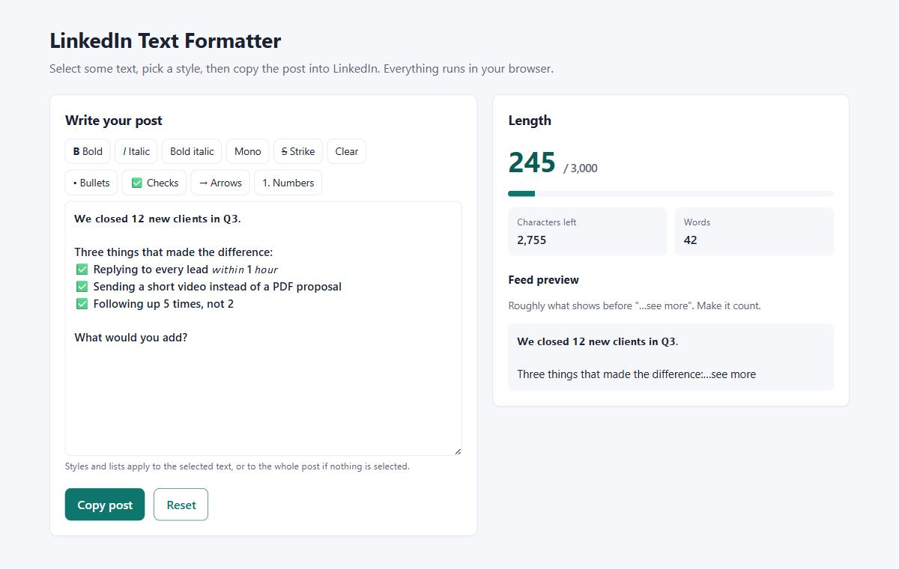

# LinkedIn Text Formatter

A small, dependency-free web app for writing LinkedIn posts. LinkedIn has no bold or italic button, so this tool swaps your letters for Unicode lookalike characters that show as bold, italic, monospace or strikethrough anywhere you paste them. It also turns lines into bullet, checkmark, arrow or numbered lists, counts characters against LinkedIn's 3,000 limit, and shows roughly what people will see before "…see more". It is aimed at founders, sales teams and agencies who post on LinkedIn and want their posts easier to skim. Everything runs in the browser; nothing is sent anywhere.

## Screenshot



## Features

- Styles: bold, italic, bold italic, monospace, strikethrough, and Clear to go back to plain text
- Lists: • bullets, ✅ checks, → arrows or 1. 2. 3. numbers, applied line by line (existing bullets are replaced, blank lines are kept)
- Works on the selected text, or the whole post if nothing is selected
- Ctrl+B / Ctrl+I (Cmd on Mac) shortcuts
- Live character count, characters left, word count and a bar that turns red over 3,000
- Feed preview of the first lines, roughly where LinkedIn cuts the post off
- Draft saved in your browser (localStorage), Reset button, Copy post to clipboard
- Responsive down to 375px, keyboard accessible, no frameworks, no build step

## How to use

Open `index.html` directly in a browser. That's it.

If you prefer serving it locally (for example so the clipboard API is available in every browser), run:

```bash
npx serve .
```

and open the URL it prints. Write or paste your post, select a line or phrase, click a style, then click **Copy post** and paste into LinkedIn.

## A worked example

The sample post that loads by default is 205 characters of plain text. In the screenshot:

1. The first line, `We closed 12 new clients in Q3.`, is selected and made **Bold**.
2. The three tip lines are selected and turned into **✅ Checks**.
3. `within 1 hour` is selected and made **Italic** (the `1` stays as it is, because Unicode has no italic digits).

The counter now reads **245 / 3,000** with 2,755 left. The post didn't get longer to the eye, but each styled letter is two characters behind the scenes. The counter measures length the way browser text boxes do, so it errs on the safe side. The bold line adds 24, the italic phrase adds 10 and the three ✅ marks with their spaces add 6: 205 + 24 + 10 + 6 = 245. A heavily styled post hits the limit sooner, so use bold for the hook and key phrases, not whole paragraphs.

The feed preview shows only the bold first line and the line after it before "…see more". That first line is what decides whether anyone clicks.

**One caution:** screen readers read styled characters out letter by letter, or skip them, and LinkedIn search may not match them. Keep styling to a few words.

## Run tests

Requires Node.js 20 or newer. There are no dependencies to install.

```bash
npm test
```

Tests use Node's built-in `node:test` runner and cover every style, converting back to plain text, digits and non-Latin characters, bullets and numbering, the character and word count, and the over-limit and "see more" checks.

## Project structure

```
.
├── index.html            Page markup
├── styles.css            Styles
├── app.js                UI wiring, selection handling, localStorage, clipboard
├── format.js             Pure formatting logic (no DOM)
├── tests/
│   └── format.test.mjs   Unit tests
├── docs/
│   └── screenshot.jpg    Screenshot used in this README
├── package.json
├── LICENSE
└── README.md
```

`format.js` is a plain script that registers `globalThis.Formatter`. That lets the page load it with a normal `<script>` tag (so it works from `file://`, where ES modules are blocked) while the tests load the same file with `import`.

## License

MIT © 2026 Socialist Fox. See [LICENSE](LICENSE).
